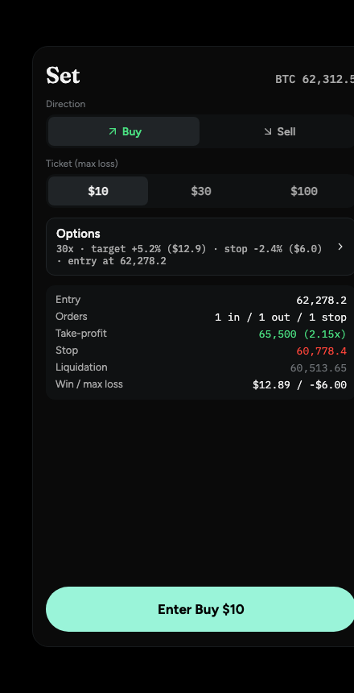

[English](README.md) | 日本語

# ワンクリックのミニトレード「Set」

**Set**は、ボタン1つで開くレバレッジ取引です。縦長のカード1枚で、ユーザーが選ぶのは次の項目だけです。

- **方向**: BuyかSellを選びます（初期値はBuy）。
- **Ticket**: $10、$30、$100のどれかです（初期値は$10）。これが証拠金です。分離マージンなら、ユーザーが失う最大額になります。
- その下の**オプション行**1行に、現在のプランから決まったオプションの中身が出ます。例えば`30x · target +5.2% ($15.6) · stop -2.6% ($7.9) · entry at market`です。タップするとオプションシートが開き、次を選べます。
  - **レバレッジ**: 30x（初期値）、50x、100x。
  - **Target（利確目標）**: Shy（損失の1倍以上）、Deserved（2倍以上、初期値）、Greedy（4倍以上）。
  - **When to enter（エントリーのタイミング）**: Now（成行注文）、Nearby（初期値）、Patient、Draw。Drawは価格の帯の上にIn帯とOut帯を描く方式で、チケットを最大5件の注文に分けます。

上の数字はすべて、1つのファイル`src/rules/defaultRules.ts`にあるルールです。デプロイごとに変えられます（「ルール」の節を参照）。

各要素の決め方は次のとおりです（2026-11-16のルール）。

- **ストップ（損切り）**: どのSetにも、清算の少し手前にストップが付きます。
  - 位置は、エントリーから清算価格までの85%の地点です。
  - そこで損切りになれば、清算で失うはずの額の約15%が手元に残ります。清算手数料もかかりません（AsterのBTCUSDTの清算手数料はポジションの2.5%です）。
  - ストップは通常の署名付き注文なので、決済にもBlackboardのビルダー手数料が適用されます。
  - 利確の倍率は、このストップまでの距離に対して測ります。これが実際の損失だからです。
  - エントリーが約定すると、Setのストップは自分の約定価格から置き直されます。
- **Nearby**: いちばん近い価格ではありません。
  - 熟練トレーダーが有利な側に置いた指値注文を使います（Buyなら現在価格より下の買い注文）。
  - 現在価格から0.05%から0.5%離れた注文を、幅0.05%の価格帯にまとめます。
  - 金額が大きい上位3つの価格帯を残します。
  - 金額で重み付けして1つを無作為に選び、その帯の中の価格を無作為に選びます。
- **Patient**: 他のトレーダーの清算価格がいちばん集まっている帯の中に指値を置きます。範囲は現在価格から0.5%から5%です（Buyなら価格より下のロング、Sellなら価格より上のショート）。
  - 読むのは、Hyperliquidのトレーダー最大約200人分です（今月の利益上位50人と、出来高で最も活発な150人）。
  - 集まりがなければNearbyに切り替え、カードにそう表示します。
- **利確**（2026-11-20と2026-11-21のルール、仕様は`Sets_Rules.md`のA節）: 目標は清算クラスターを探します。いちばん近い価格でも、単純な2倍でもありません。
  - 探す範囲は、下限（ストップ距離のShy 1倍、Deserved 2倍、Greedy 4倍）の0.1x内側から、下限の2倍までです。
  - クラスターは、他のトレーダーのポジションが強制決済される価格です（ロングなら上のショート、ショートなら下のロング）。出来高が最も多いHyperliquidの600アカウントから作った清算マップを使います。
  - 互いにいちばん近い価格との差が1.5%以内の価格を、すべて1つのクラスターにまとめます。
  - クラスターとして数えるのは、群れと言える場合だけです。条件は4つです。$100,000以上。2アカウント以上。最大のアカウントが金額の90%以下。そのアカウントを除いても$100,000以上。
  - クジラ1人と小口だけの帯は、数えますが使いません。その帯が選ばれていたはずの場合は、文の中でその帯を名指しします。
  - ブレーキは4種類です。板の注文の壁（Asterの板と熟練トレーダーの注文、$25,000から）。キリのいい価格。直近の高値か安値。熟練トレーダーの見えている利確注文。
  - 各価格に点数を付けます。要素は、引き寄せる力（金額とアカウント数）、現在の1時間あたりのボラティリティで24、48、96時間以内にそこへ届く確率（3%未満は除外）、途中にあるブレーキ1つにつき0.8、倍率（Greedyでは重みを大きくします）です。
  - 点数が最も高い価格が選ばれます。
  - 目標は、ブレーキのすぐ手前か、クラスターの端から0.05%内側に置きます。ブレーキの後ろ0.1%以内には置きません。1倍未満にもしません。
  - 届く範囲に何もなければ、下限そのものを使います。
  - どのプランにも1文が付き、ポジションとすべての価格の動作を書きます。例えば"Long from 1,805.73; take profit (sell) at 1,949.41, 3.02x the stop (sell at 1,758.19): the sale sits just in front of 1,950 (a round number) at the edge of a cluster where $2.5M of 3 accounts' shorts get liquidated (1,950.4 to 1,951.9; the largest holds 36%)"です。
  - ログと一覧では短い形を使います。例えば"ETH Short from 1,764.96, buy back 1,667.52 (2.29x), stop 1,807.46"です。
- **清算マップはカードが開いている間だけ読みます**（2026-11-21）。サーバーの起動時には何も読みません。
  - 最初のプレビュー（または価格帯の読み込み、発注）で、最大の200アカウントを一度に読みます（リクエストウェイト約400、数秒）。待つのは最大8秒です。
  - 残りの400アカウントは、2分以内に順に読みます（1分あたり最大500ウェイト）。カードは30秒ごとに新しいプレビューを求めるので、完成したマップがカードに届きます。
  - カードが求め続けている間は、マップ全体を5分ごとに読み直します。10分間リクエストがなければ止めます。
  - 答えは5分間は新しいものとして使い、15分を過ぎたら使いません。
  - 熟練トレーダー自身の価格（Nearby、Patient、Nowの目標の壁）は、カードが求めている間も最大5分に1回しか読みません。そのため、マップの読み込みを邪魔しません。そのデータの古さは、件数と、NearbyやPatientの理由に表示します。
  - どのエントリーモードでも、清算マップを熟練トレーダーの価格より先に読みます。
  - リクエストの10%を超えて取りこぼしたトレーダーの読み込みは、60秒しか使い回しません。
  - マップを読んでいる間、カードに1行だけ「Reading the liquidation map (200 of 600)」と表示します。
  - 期限切れのアカウント一覧は、新しい一覧をダウンロードしている間もすぐに使います。コピーが1つもない場合も、最初のプレビューは8秒以内に答え、一覧をまだダウンロード中だと伝えます。
  - トライアルモードも、ライブとまったく同じ動きをします。
  - `GET /api/health`で、Hyperliquidに送ったリクエスト数を確認できます（最初のプレビューまでは0）。
- **追いかけ禁止**（オーナーの絶対ルール、2026-11-21）: すでに値幅の端まで来た動きを追うSetは拒否します。反対側に切り替えることはしません。
  - 追いかけと判定するのは、Setのエントリー価格（Nearby、Patient、Drawでは指値の価格）が次の2つを両方満たすときです。
  - 1つ目。直近72時間の値幅（3%以上あるとき）のうち、自分の側の外側10%にある。
  - 2つ目。直近24時間の反対側の極値から、1日の典型的な値動きの1.5倍以上離れている。
  - このとき、プレビューと発注は`"status": "refused: chasing"`と理由の文を返します。文は2行です。例えば"ETH fell 10.3% in a day, below its 3-day low."と"A Short here would follow the move at its edge."です。反対側をプレビューするヒントも返します。
  - カードは、その2行と、ボタン「Preview a Long instead」または「Preview a Short instead」を表示します。
  - Asterの1時間足を読めないときは判定できないので、そのSetも拒否します（`"status": "refused: guard unavailable"`、エラー内容付き、ボタンなし）。

指値の価格はすべて、最大0.05%の範囲で無作為にずらします。多くのSetが同じ価格に重ならないようにするためです。乱数はすべて、外から渡す1つの乱数源から取ります。そのため、シードを決めれば同じSetを再現できます（テストはこれを使い、プレビューのルートは`"seed"`を受け付けます）。勝ったSetでは、利益の5%がBlackboardに、5%がコピー元のトレーダーに入ります。負けたSetは何も払いません。

注文は**Aster**に送ります。熟練トレーダーの価格は**Hyperliquid**から取ります。Asterは他のユーザーのポジションや注文を公開していませんが、Hyperliquidは公開しているからです。BTCとETHは、どちらの取引所でもほぼ同じ価格で取引されています。

## 構成と、Blackboardがコピーするもの

| 部分 | フォルダ | Blackboardにコピーするか |
|---|---|---|
| コアの計算。エントリー、価格のずらし、利確、ストップ、清算、Drawの分割、手数料、アラート、入力チェック、Setの台帳、発注前チェック | `src/core/` | はい。最初に、そのまま、`src/rules/`と一緒にコピーします。素のTypeScriptで、ネットワーク、React、依存パッケージを使いません。 |
| ルールセット。調整できるすべての数値と、上書きのチェック | `src/rules/`（`defaultRules.ts`、`rules.ts`） | はい。Blackboardは独自の初期値か上書きファイルを同梱します。「ルール」の節を参照。 |
| Hyperliquidから取る熟練トレーダーの価格 | `src/levels/hyperliquid.ts` | はい。バックエンドで動かします（39 MBのリーダーボードをダウンロードし、1回の更新で約200リクエストを送ります。更新は1分に最大1回です。スマホでは動かさないでください）。 |
| Aster V3クライアント。EIP-712署名、注文、板、レバレッジブラケット、ポジション、注文照会、ユーザーデータストリームのキー、ビルダー項目 | `src/exchange/aster.ts` | はい。署名鍵がある場所で動かします。`asterTypedData()`はPrivyウォレットのsignTypedDataでも動きます。 |
| ウォッチャー。ポジションが別の場所で決済されたとき、そのSetの決済注文を取り消します | `server/watch.ts` | はい。バックエンドで、アカウントごとに1つ動かします。 |
| カード | `src/components/`（`SetCard.tsx`、`SetOptionsSheet.tsx`、`setSummary.ts`、`PriceStrip.tsx`、`useSetSession.ts`） | はい。デモサーバーの代わりに、自分の`api`プロップ（`src/api/client.ts`を参照）を渡します。`getRules()`も渡すと、カードがルールセットのチケットとレバレッジを表示します。色とフォントは`src/theme.ts`から取ります。 |

`server/`はデモ用の署名サーバーです。やり取りの仕様（下のルート）を示します。秘密鍵を置くのはここだけで、ブラウザが鍵を見ることはありません。

技術スタックはBlackboardのアプリと同じです。React 18、TypeScript（strict）、Vite、styled-components、TanStack Query、viem、lucide-react、Vitest。

## セットアップ

1. `npm install`
2. 任意。ライブ注文を出すときだけ、`.env.example`を`.env`にコピーし、次の4つの値を入れます。
   - `ASTER_USER`: メインアカウントのアドレス（Blackboardでは、Settings、Accountにある埋め込みEVMアドレス）。
   - `ASTER_SIGNER`: AsterのAPIウォレットのページ（<https://www.asterdex.com/en/api-wallet>、「Pro API」）で承認したAPIウォレットのアドレス。
   - `ASTER_SIGNER_PRIVATE_KEY`: そのAPIウォレットの秘密鍵。
   - `LIVE_TRADING`: 本当にライブで取引するまでは`false`のままにします。
   ほかに任意の値が2つあります。`SETS_RULES_FILE`（`rules/my-rules.json`以外のルールファイル）と、`ASTER_EXIT_REDUCE_ONLY`（`true`か`false`、初期値は`true`。「未解決の項目」を参照）です。
3. `npm run server`（デモサーバー、<http://127.0.0.1:8787>）
4. 2つ目のターミナルで`npm run dev`を実行し、<http://localhost:5173>を開きます。

その他のスクリプトは次のとおりです。`npm test`、`npm run typecheck`、`npm run build`、`npx tsx scripts/watch.ts`（ウォッチャーを単体で動かします）、`npx tsx scripts/check-account.ts`（アカウントを読むだけで、何も送りません）。

## トライアルモードとライブモード

- **トライアル（初期設定）**: `POST /api/set/place`はプラン全体を作り、`logs/plans.jsonl`に記録し、`"status": "trial: not sent"`を返します。カードはその後、実際の価格でSetをシミュレーションとして追います（進捗バー、半分到達のアラート、手数料の内訳付きの結果）。
- **ライブ**: 次の3つをすべて満たすときだけです。
  - `LIVE_TRADING=true`。
  - チケットがライブの上限以下（ルール`live.maxTicketUsd`、初期値$10。`MAX_LIVE_TICKET_USD`を設定するとそちらが優先）。
  - 銘柄がルール`live.symbols`に入っている（初期値はBTCUSDTとETHUSDT）。
  - 起動時、サーバーは鍵が`ASTER_SIGNER`のものか確かめ、署名付きの読み取りを1回行います。どちらかが失敗すると、メッセージを出して止まります。
  - ライブのSetは、アカウントのポジションモードを読みます。ポジションモードもマージンタイプも変えません。
  - その銘柄にすでにポジションかライブのSetがあれば、Setを拒否します（「マージしない」の節を参照）。
  - 残高とクロスマージンのルールを確かめ、銘柄のレバレッジをSetのレバレッジに設定します。
  - エントリーを、利確とストップ付きの1つのOTOCO注文として送ります。エントリーが約定するとAsterが2つの決済注文を置き、どちらかが約定するともう一方は取り消されます。
  - Setはすべて`logs/set-ledger.json`に記録されます。`GET /api/sets`は、Setごとの利益付きで一覧を返します。
  - ライブモードでは、サーバーはウォッチャーも動かします（「ウォッチャー」の節を参照）。
- **約定後**: `server/execute.ts`の`handleOrderUpdate()`が、Asterのユーザーデータストリームから注文イベントを1つずつ受け取ります。
  - 決済注文の数量を、実際に約定した量に合わせます。
  - ストップをSet自身のストップに動かします（チケットの85%。Asterの実際の清算距離の85%を超えることはありません。`GET /fapi/v3/positionRisk`）。
  - 次に、実際の約定価格に対して目標を測り直します。下限マイナス0.1x以上なら、何も動かしません。
  - 下回ったときは、プランに保存した価格から目標を選び直します。良くなった価格はログに残すだけで、発注しません（"kept, update unproven"）。`updateStrategyOrder`がライブで確認できるまでの扱いです（オプション`replaceTakeProfitAfterFill`）。
  - エントリーとストップは動かしません。
  - `GET /api/sets`は、各Setの倍率を実際の約定価格に対して表示します。
  - デモサーバーのウォッチャーはイベントを記録しますが、決済注文の数量は変えません（`updateStrategyOrder`はライブで未確認のため）。`handleOrderUpdate`を動かすのはBlackboardのバックエンドです。
- **ビルダーの帰属**: `ASTER_BUILDER_ADDRESS`と`ASTER_BUILDER_FEE_RATE`を設定すると、ストップを含むすべての署名付き注文に`builder`と`feeRate`が付きます。`ASTER_BUILDER_FEE_RATE`は小数で指定します（例えば`0.0001` = 0.01%）。上限は`0.001`で、これはBlackboardの承認の上限です。

## サーバーのルート

- `GET /api/price?symbol=BTCUSDT`: Asterの最新価格。
- `GET /api/levels?coin=BTC`: 熟練トレーダーの指値注文、利確注文、清算価格と、その件数（読んだアドレス数、清算価格のあるポジション数、注文数、使ったリクエストウェイト）。清算マップの件数も返します（問い合わせたアカウント数、回答数、レート制限の枠で飛ばした数、価格より上のショートと下のロングの価格数、20%以内の帯の数）。価格帯を求めると、清算マップの読み込みも始まります（完了は待ちません）。
- `POST /api/set/preview`: プラン全体と、Asterに送る注文の各レッグをそのまま返します。プランの中身は、エントリー、ずらした価格、数量、ストップ、清算、理由付きの利確、点数上位5つの価格と件数、倍率、想定利益と最大損失、手数料の内訳、構造の件数です。
  - ボディは`{"symbol":"BTCUSDT","side":"buy","ticketUsd":10,"leverage":30,"tpMode":"deserved","entryMode":"nearby"}`です。
  - 同じ乱数の選び方を繰り返すには、`"seed": 1`を加えます。
  - Drawでは`"draw":{"inBand":{"low":..,"high":..},"outBand":{"low":..,"high":..}}`を加えます。
  - 鍵が設定されていれば、ライブのチェックも行います。その拒否か警告を`check`として返します。
  - 追いかけと判定すると、409で`"status": "refused: chasing"`を返します。理由の文は`message`に入り、`hint`も付きます（`label`は"preview a Long instead"、反対側の入力付き）。
  - 1時間足を読めないときは、409で`"status": "refused: guard unavailable"`を返します。`hint`はnullです。
- `POST /api/set/place`: ボディは同じです。上のとおり、トライアルかライブで動きます。トライアルの答えには、`setId`と、クライアント注文ID付きのレッグも入ります。ライブのSetを拒否したとき（その銘柄にポジションかSetがある、残高、清算のルール）は、409と分かりやすい`message`を返します。何も送っていません。
- `GET /api/sets`: 台帳にあるすべてのSetを、状態と、そのSet自身の約定から出した利益付きで返します。各行には`headline`が付きます（"ETH Long from 1,805.73, sell 1,899.43 (1.97x), stop 1,758.19"）。
- `GET /api/rules`: 有効なルールセットと、その読み込み元のファイル。

## マージしない: 1銘柄に1つのSet（オーナーの決定、2026-11-20）

Asterの1つのアカウントでは、1つの銘柄が持てるポジションは1つです（ヘッジモードでは片側に1つずつ）。すでにポジションがある銘柄でSetを開くと、そのポジションに合算されます。エントリー価格も清算価格も1つになり、どちらを決済しても両方が決済されます。そのため、Setのポジションはほかのどのポジションとも合算しません。

- **何かを送る前に拒否します**（`src/core/risk.ts`の`checkCoinIsFree`。`server/execute.ts`の`preTradeCheck`が呼びます）。
  - 対象は、その銘柄にポジションがあるときです。ユーザー自身のものでも別のSetのものでも、どちら側でも拒否します。
  - 台帳にライブのSetがあるときも拒否します（板に置いた指値のエントリーも含みます）。
  - メッセージは分かりやすい文です。例えば"ETH already has an open position. A Set never shares a coin with another position, so nothing was sent."です。
- **別の銘柄なら問題ありません**。ただし同じクロスマージンの余力を共有するので、2つのチェックは残ります。
  - ほかのポジションの清算価格を、現在価格に30%を超えて近づける場合は拒否します（10から30%は警告）。
  - 自分のストップが、予測した清算価格までの85%の地点より先になる場合も拒否します。
  - 証拠金については、空き残高がチケットを賄えることを確かめます。口座の資産（`GET /fapi/v3/account`）が、開いているすべてのチケットとこのSetのチケットを賄えることも確かめます。口座の資産を見るのは、Blackboardのアカウントがマルチアセットマージンで、USDTウォレットだけでは少額だからです。
- **設定はそのままにします**。ポジションモードとマージンタイプは読むだけで、変えません。ワンウェイモードでは、Setの決済注文はSetと同じ数量の反対注文です。ヘッジモードでは、BuyのSetはLONG側、SellのSetはSHORT側を使います。
- **Setごとにidがあります**。すべての注文にそのidが付きます（`set_...-1E`はエントリー、`-1T`は利確、`-1S`はストップ）。そのため、Setごとの約定と利益が分かります。利益の分配は、そのSet自身の約定から、そのSet自身の取引手数料を引いた後で計算します。損失のときと、Setの外で決済されたときは、何も発生しません。
- **古い台帳も使えます**。決定より前に保存した台帳には、1銘柄に複数のSetや、ユーザー自身のポジションが`outside`として入っていることがあります。台帳はそれも読み込み、照合します（`reconcile`、`syncSetExits`、`symbolLeverageTarget`）。

**本番で推奨する構成（オーナーの決定、2026-11-20）は、ユーザーごとにSets用のサブアカウントを1つ作り、銘柄ごとに分離マージンにする形です。** 同じ銘柄のSetと手動のポジションを分けておけるのは、アカウントを分けたときだけです。分離マージンは銘柄ごとの設定で、2つ目のポジションは作りません。ヘッジモードが分けるのは、ロングとショートだけです。Asterには、独自のウォレットアドレスを持つサブアカウントがあります（V3のドキュメント「Create Sub-Account」、`POST /fapi/v3/createSubAccount`。資金は「Sub-Account Transfer」で移します）。そこで、きれいな構成は次のとおりです。各ユーザーがSets用のサブアカウントを持ちます。最初のSetの前に、そのアカウントをワンウェイ、シングルアセットマージンにし、銘柄ごとにISOLATEDに設定します。するとAster自身の清算価格がSetの清算価格と一致し、チケットが損失の上限になります。このMVPでは、この構成をまだ作っていません。Asterのドキュメントによると、サブアカウントを作れるのはホワイトリストに入ったアドレスだけです（"contact the project team"）。これはBlackboardが手配できます。ビルダーの承認も、新しいアドレスから出す必要があります。それまでMVPは、上の「マージしない」ルールのもと、メインアカウントで動きます。

## ウォッチャー（`server/watch.ts`）

ワンウェイモードでは、Setの決済注文はただの反対注文です。ユーザーがBlackboardのアプリで手動でポジションを決済しても、利確とストップは板に残ります。後でどちらかが発動すると、逆向きの新しいポジションが開きます。ウォッチャーは、残った決済注文を取り除きます。

- **ルール**: 対象は、決済注文の1つがまだ有効なのに、銘柄のポジションが0か、Setの約定数量をもう賄っていないライブのSetです。
  - 5秒以上あけて2回確認します（ポジションは、約定イベントより少し早く動くためです）。
  - 次に、Asterから両方の決済注文を読み戻します（クライアント注文IDで`GET /fapi/v3/order`）。
  - 決済注文が約定していれば、Setは自分で決済したということです。そう記録し、もう一方の決済注文だけを取り消します。
  - そうでなければ、両方の決済注文と未約定のエントリーを、クライアント注文IDで取り消します。Setは理由"closed outside the Set"で決済済みにします。
  - ウォッチャーが注文を出すことはありません。
- **気づく方法は2つです**。
  - (a) Asterのユーザーデータストリーム。listenKey（`POST /fapi/v3/listenKey`。アカウントに有効なキーがあれば、それを返します）を、30分ごとの`PUT`で維持します。ストリームが閉じたら1秒後に再接続し、待ち時間を倍にしながら最大60秒まで延ばします。注文イベントは台帳に記録します。ライブのSetがある銘柄でポジションイベントが来たら、チェックを走らせます。
  - (b) ライブのSetがある銘柄ごとに、15秒ごとに`positionRisk`を問い合わせます。2026-11-19のライブテストで、ストリームが数分後に自分で閉じたためです。
- **取りこぼしの回収**: 台帳が終わりを確認していないエントリーは、チェックのたびに読み戻します。そのため、誰も聞いていない間に約定したものも数に入ります（2026-11-19のライブのETHのSetがその例です。デモサーバーにストリームがありませんでした）。
- **ログ**: すべての動作は`logs/watch.jsonl`とコンソールに出ます。チェックごとに件数の行も出ます（ライブのSet、ポジション、未カバー、対応した数、取り消した数）。
- **動かし方**: デモサーバーは、ライブモードでウォッチャーを起動します。
  - 単体では`npx tsx scripts/watch.ts`で動かします（ライブでは鍵と`LIVE_TRADING=true`が必要です）。
  - `npx tsx scripts/watch.ts --dry`は、取り消す予定のものを報告するだけで、何も変えません。ストリームのキーは開きますが、それで取引は起きません。
  - ウォッチャーはアカウントごとに1つだけ動かします。ライブのデモサーバーと並べて、このスクリプトを動かさないでください。

## ルール（`src/rules/`）

Blackboardが受け取るのは、この構成と、変更できる初期のルールセットです。オーナーはそれぞれ自分のルールを持てます。

- `src/rules/defaultRules.ts`には、調整できる数値がすべて入っています。それぞれに1行の説明が付いています。中身は次のとおりです。
  - 清算までの距離に対するストップの割合（0.85）と、チケットに対する割合（0.85）。
  - 利確の倍率（損失のShy 1倍、Deserved 2倍、Greedy 4倍）と、初期の目標。
  - 目標の探索。0.1xのゆとり、下限の2倍までの探索範囲、目標の選択ごとの時間と倍率の重み、ボラティリティの参照期間と下限、届く確率3%での足切り、クラスター幅1.5%、最低$100,000、2アカウント以上、最大のアカウントは90%以下、そのアカウントを除いて$100,000、内側への寄せ幅とトレーダーボーナス、清算マップの大きさ、クイックマップの大きさ（200）、待ち時間（8秒）、鮮度（5分）、アイドル停止（10分）と再読み込み、ブレーキの重みとペナルティ、ブレーキの影、ブレーキのすぐ後ろに置かない0.1%の幅、最小の壁$25,000、帯の幅、手前の隙間、無作為なずらし、スイング高値のローソク足。
  - 追いかけ防止（`chase`: オン、端10%、値幅3%以上、1日の値動きの1.5倍）。
  - 古いキー`wallSearchReach`、`roundNumberReach`、`fuelBandWidth`、`fuelMaxBands`は、1リリースの間は読み込まれ、無視されます。
  - エントリーの初期値と、Nearby、Patient、Drawの調整項目。
  - 価格のずらし（0.05%）。
  - チケットの選択肢（10、30、100）と初期値。
  - レバレッジの選択肢（30、50、100）と初期値（30）。
  - 清算が近づく割合による拒否（0.30）と警告（0.10）。
  - 想定する維持証拠金率と手数料率。
  - 利益の分配（Blackboardに5%、コピー元のトレーダーに5%）。
  - ライブの上限。
- **上書き**は、初期値の上に重ねるJSONファイルです。`SETS_RULES_FILE`を設定していればそのファイルを使います。なければ、`rules/my-rules.json`があればそれを使います（gitには入れません）。始めるには`rules/my-rules.example.json`をコピーします。書かなかったキーは初期値のままです。`_`で始まるキーはメモです。
- **読み込み時にチェックします**。未知のキー、型の誤り、範囲外の値、互いに矛盾するルール（選択肢にない初期値、拒否の値より大きい警告の値）があると、サーバーはキーの名前を出して止まります。例えば`unknown rule "target.greedyy"`です。
- `GET /api/rules`は、有効なルールセットとそのファイルを表示します。カードは`api.getRules()`でこれを読みます。そのため、カードのチケット、レバレッジ、初期値、ヒントはファイルに従います。

## リスクについて

- **ストップは清算の少し手前にあります**。ストップはストップ成行注文です。急な価格の飛びでは、指定した価格より悪い価格で約定することがあります。価格が清算価格を飛び越えると、取引所が代わりに清算します。分離マージンなら、損失は証拠金までに収まります。クロスマージンでは、損失を抑えるのはストップだけです。Setが銘柄を分離マージンに切り替えることはありません（その設定はユーザーのBlackboardアプリが持っています）。そのため、クロスマージンのアカウントでは、ストップが唯一の上限です。
- **ワンウェイモードの決済注文はただの反対注文です**。reduce-onlyでない決済注文が手動決済の後に残ると、発動したときに新しいポジションを開きます。ウォッチャーは、これを約15から30秒以内に取り消します。reduce-onlyの決済注文なら、この穴はふさがります（「未解決の項目」を参照）。
- **表示される最大損失は、ストップで決済したときの損失です**。取引所の取引手数料とファンディング手数料は含みません。チケット$10、30xでは約$6.20です（2026-11-16のスモークテスト）。数量がAsterのBTCの刻み0.001に切り捨てられるためです。また、ストップは、維持証拠金の分だけ短くなった距離の85%に置かれます。
- **レバレッジの規制は国によって違います**。暗号資産デリバティブで個人のレバレッジに上限を設けている国や、全面的に禁止している国があります。30xから100xを提供する前に、各ユーザーの居住国を確かめてください。
- **価格帯はあくまで目安です**。Hyperliquidで意味のあった価格が、Asterでも同じように機能するとは限りません。

## 未解決の項目

- **reduce-onlyの決済注文は初期設定でオンです。2026-11-19にライブで確認しました**。
  - AsterのV3ドキュメント（<https://github.com/asterdex/api-docs>、`V3(Recommended)/EN/aster-finance-futures-api-v3.md`、「Place Strategy Order」の子注文の項目）は、各OTOCO子注文の任意のSTRING項目として`reduceOnly`（"Reduce-only flag"）と`closePosition`（"Close-position flag"）を載せています。「Update Strategy Order」にも両方あります。
  - そのため、`ASTER_EXIT_REDUCE_ONLY=true`にすると、ワンウェイモードで両方の決済注文に`reduceOnly: "true"`が付きます。ヘッジモードでは付けません。通常の注文のドキュメントが、ヘッジモードでの使用を禁じているためです。
  - ライブでの確認は、2026-11-19の22:13から22:14 UTCに、30xの$10のETHのSet 1つで行いました。Asterは両方の決済注文で`reduceOnly`を受け付けました。
  - 外部の成行注文でポジションを決済すると（Blackboardの手動決済が送るのと同じ形）、Asterは1秒以内に両方の決済注文を自分で失効させました。その後、ウォッチャーがSetを"closed outside the Set"として閉じました。
  - 初期値は`true`です。`ASTER_EXIT_REDUCE_ONLY=false`でオフになります。
  - オンのとき、ウォッチャーの予備の問い合わせは15秒ごとから60秒ごとに遅くなります（ストリームはすぐに反応します）。開いているSetがない間、その問い合わせはAsterに何も聞きません。
- **ウォッチャーにはライブで未確認の部分があります**。`origClientOrderId`を使った`GET /fapi/v3/order`によるOTOCO子注文の読み戻しと、数時間にわたる再接続のループです。最初は`npx tsx scripts/watch.ts --dry`を動かし、`logs/watch.jsonl`を読みます。
- まだ未確認なのは、`POST /fapi/v3/updateStrategyOrder`による有効な決済注文の数量変更と、`origClientOrderId`による子注文1つの取り消しです。どちらも、確かめるには部分約定か手動決済が必要です。
- AsterのV3ドキュメントで`builder`と`feeRate`が載っているのは、戦略注文のエンドポイントだけです。ライブのSetはこのエンドポイントを使います。通常の`POST /fapi/v3/order`にも付けているのは、Blackboardのガイドがそう求めているからです。ただし、その表には載っていません。ドキュメントには、載っていないパラメータは拒否されると書かれています。
- Patientには、現在価格の近くに清算価格が必要です。範囲を広げた集合（2026-11-16時点で171人のトレーダー）では、Sellは価格の4.15%上にショートのクラスターを見つけました。一方、Buyは5%下までにロングの清算を見つけられず、PatientのBuyはNearbyに切り替わりました。Hyperliquidの公開清算フィードを使えば、さらに増えます。
- 2026-11-19にライブで確認済みのこと（30xの$10のETHのSet 1つ）。
  - `nonce`、`user`、`signer`による署名。
  - OTOCOで、エントリーが1,805.73で0.166約定し、利確1,900.12とストップ1,758.19をAsterが置いたこと。
  - すべての注文イベントに、こちらのクライアント注文IDと`si`（strategyId）、`ss`（sub id）が付いていたこと。
  - Asterのゲートウェイは、エントリーのレッグに`firstDrivenId: "0"`と`secondDrivenId: "0"`を必要とします。ドキュメントでは任意となっています。
- 目標v2の残り。
  - 理由の文と見出しはプランと`GET /api/sets`に入っていますが、カードにはまだ表示していません。"1.97x against the real fill"、"reading the liquidation map"の行、追いかけ拒否の"preview a Long instead"ボタンも同じです（デザイナーと文言の作業です。サーバーはすでにこれらを返しています）。
  - クラスターの最低額（$100,000）とブレーキのペナルティ（0.8）は、仮の初期値です。目標の結果が出たら、`logs/plans.jsonl`から調整します。
  - 清算マップは、1つの取引所のクジラだけを見ています。実際のクラスターの下限にあたり、ほとんどの帯はトレーダー1人分です。
- 約定前のトライアルモードには、レバレッジブラケットがありません（署名付きの呼び出しが必要なためです）。そのため、維持証拠金率を0.5%と仮定します（ルール`risk.assumedMaintenanceRate`）。ライブモードは実際のブラケットを読みます。
