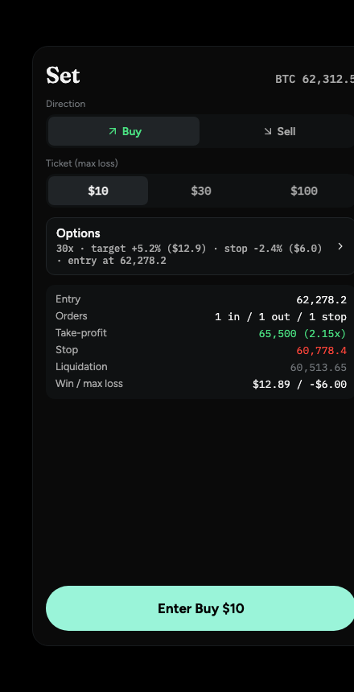

[English](README.md) | [日本語](README.ja.md) | 한국어

# 원클릭 미니 트레이드: Set

**Set**은 버튼 하나로 여는 레버리지 거래입니다. 세로형 카드 한 장에서 사용자가 고르는 것은 다음뿐입니다.

- **방향**: Buy 또는 Sell입니다(기본값 Buy).
- **Ticket**: $10, $30, $100 중 하나입니다(기본값 $10). 이것이 증거금입니다. 격리 마진에서는 사용자가 잃을 수 있는 최대 금액입니다.
- 그 아래 **옵션 줄** 한 줄에 현재 플랜에서 정해진 옵션 내용이 나옵니다. 예를 들면 `30x · target +5.2% ($15.6) · stop -2.6% ($7.9) · entry at market`입니다. 누르면 옵션 시트가 열리고 다음을 고를 수 있습니다.
  - **레버리지**: 30x(기본값), 50x, 100x.
  - **Target(익절 목표)**: Shy(손실의 1배 이상), Deserved(2배 이상, 기본값), Greedy(4배 이상).
  - **When to enter(진입 시점)**: Now(시장가 주문), Nearby(기본값), Patient, Draw. Draw는 가격 막대 위에 In 구간과 Out 구간을 그리는 방식입니다. 티켓은 최대 5개 주문으로 나뉩니다.

위의 숫자는 모두 파일 하나, `src/rules/defaultRules.ts`에 있는 규칙입니다. 배포마다 바꿀 수 있습니다("규칙" 절 참고).

각 요소를 정하는 방법은 다음과 같습니다(2026-11-16 규칙).

- **스톱(손절)**: 모든 Set에는 청산 직전에 스톱이 붙습니다.
  - 위치는 진입가에서 청산가까지 거리의 85% 지점입니다.
  - 그곳에서 손절되면 청산 때 잃을 금액의 약 15%가 남습니다. 청산 수수료도 내지 않습니다(Aster의 BTCUSDT 청산 수수료는 포지션의 2.5%입니다).
  - 스톱은 일반 서명 주문이므로 포지션 종료에도 Blackboard의 빌더 수수료가 적용됩니다.
  - 익절 배율은 이 스톱까지의 거리를 기준으로 잽니다. 이것이 실제 손실이기 때문입니다.
  - 진입이 체결되면 Set의 스톱은 자신의 체결가를 기준으로 다시 설정됩니다.
- **Nearby**: 가장 가까운 가격이 아닙니다.
  - 숙련 트레이더들이 유리한 쪽에 걸어 둔 지정가 주문을 씁니다(Buy라면 현재가 아래의 매수 주문).
  - 현재가에서 0.05%에서 0.5% 떨어진 주문을 폭 0.05%의 가격대로 묶습니다.
  - 금액 기준 상위 3개 가격대를 남깁니다.
  - 금액으로 가중치를 두어 하나를 무작위로 고릅니다. 그다음 그 가격대 안의 가격을 무작위로 고릅니다.
- **Patient**: 다른 트레이더들의 청산가가 가장 많이 모인 구간 안에 지정가 주문을 둡니다. 범위는 현재가에서 0.5%에서 5%입니다(Buy라면 가격 아래의 롱, Sell이라면 가격 위의 숏).
  - 최대 약 200명의 Hyperliquid 트레이더를 읽습니다(이번 달 수익 상위 50명과 거래량 기준 가장 활발한 150명).
  - 모인 구간이 없으면 Nearby로 전환하고 카드에 그렇게 표시합니다.
- **익절**(2026-11-20, 2026-11-21 규칙, 사양은 `Sets_Rules.md` A절): 목표는 청산 클러스터를 찾습니다. 가장 가까운 가격도, 단순한 2배도 아닙니다.
  - 탐색 범위는 하한(스톱 거리의 Shy 1배, Deserved 2배, Greedy 4배)의 0.1x 안쪽부터 하한의 2배까지입니다.
  - 클러스터는 다른 트레이더들의 포지션이 강제 청산되는 가격입니다(롱이라면 위의 숏, 숏이라면 아래의 롱). 거래량이 가장 많은 Hyperliquid 계정 600개로 만든 청산 맵을 씁니다.
  - 가장 가까운 가격과의 차이가 1.5% 이내인 가격을 모두 하나의 클러스터로 묶습니다.
  - 클러스터는 무리일 때만 셉니다. 조건은 4가지입니다. $100,000 이상. 계정 2개 이상. 가장 큰 계정이 금액의 90% 이하. 그 계정을 빼도 $100,000 이상.
  - 고래 한 명과 잔챙이뿐인 구간은 세지만 쓰지 않습니다. 그 구간이 이겼을 경우에는 문장에서 그 구간을 밝힙니다.
  - 브레이크는 4가지입니다. 대기 주문의 벽(Aster 호가창과 숙련 트레이더 주문, $25,000부터). 라운드 넘버. 최근 고점이나 저점. 숙련 트레이더의 보이는 익절 주문.
  - 각 가격에 점수를 매깁니다. 요소는 끌어당기는 힘(금액, 계정 수), 현재 시간당 변동성으로 24, 48, 96시간 안에 그 가격에 닿을 확률(3% 미만은 제외), 가는 길에 있는 브레이크 하나당 0.8, 배율(Greedy에서는 가중치를 더 둡니다)입니다.
  - 점수가 가장 높은 가격이 선택됩니다.
  - 목표는 브레이크 바로 앞이나 클러스터 가장자리에서 0.05% 안쪽에 둡니다. 브레이크 뒤 0.1% 이내에는 두지 않습니다. 1배 미만으로도 두지 않습니다.
  - 닿을 수 있는 범위에 아무것도 없으면 하한 그대로를 씁니다.
  - 모든 플랜에는 한 문장이 붙습니다. 포지션과 모든 가격의 동작을 적습니다. 예: "Long from 1,805.73; take profit (sell) at 1,949.41, 3.02x the stop (sell at 1,758.19): the sale sits just in front of 1,950 (a round number) at the edge of a cluster where $2.5M of 3 accounts' shorts get liquidated (1,950.4 to 1,951.9; the largest holds 36%)"
  - 로그와 목록은 짧은 형식을 씁니다. 예: "ETH Short from 1,764.96, buy back 1,667.52 (2.29x), stop 1,807.46"
- **청산 맵은 카드가 열려 있는 동안에만 읽습니다**(2026-11-21). 서버 시작 시에는 아무것도 읽지 않습니다.
  - 첫 미리보기(또는 가격대 읽기, 주문)에서 가장 큰 계정 200개를 한 번에 읽습니다(요청 가중치 약 400, 몇 초). 최대 8초까지 기다립니다.
  - 나머지 400개는 2분이 안 되는 시간에 걸쳐 이어서 읽습니다(분당 최대 가중치 500). 카드는 30초마다 새 미리보기를 요청하므로 완성된 맵이 카드에 도착합니다.
  - 카드가 계속 요청하는 동안에는 맵 전체를 5분마다 다시 읽습니다. 10분 동안 요청이 없으면 멈춥니다.
  - 응답은 5분 동안 최신으로 씁니다. 15분이 지나면 쓰지 않습니다.
  - 숙련 트레이더 자신의 가격(Nearby, Patient, Now 목표의 벽)은 카드가 요청하는 동안에도 5분에 최대 한 번만 읽습니다. 그래서 맵 읽기를 방해하지 않습니다. 그 데이터가 얼마나 오래됐는지는 건수와 Nearby 또는 Patient의 이유에 표시합니다.
  - 모든 진입 모드에서 청산 맵을 트레이더 가격보다 먼저 읽습니다.
  - 요청의 10%를 넘게 놓친 트레이더 읽기는 60초 동안만 재사용합니다.
  - 맵을 읽는 동안 카드에는 한 줄만 표시됩니다: "Reading the liquidation map (200 of 600)"
  - 만료된 계정 목록은 새 목록을 내려받는 동안 바로 씁니다. 사본이 하나도 없어도 첫 미리보기는 8초 안에 응답합니다. 이때 목록을 아직 내려받는 중이라고 알립니다.
  - 체험 모드도 실거래와 똑같이 동작합니다.
  - `GET /api/health`는 Hyperliquid에 보낸 요청 수를 보여 줍니다(첫 미리보기 전까지 0).
- **추격 금지**(오너의 절대 규칙, 2026-11-21): 이미 범위 끝까지 온 움직임을 따라가는 Set은 거부합니다. 반대 방향으로 뒤집지 않습니다.
  - 추격으로 판정하는 것은 Set의 진입가(Nearby, Patient, Draw에서는 지정가)가 다음 두 조건을 모두 만족할 때입니다.
  - 첫째, 최근 72시간 변동 범위(3% 이상일 때)에서 자기 쪽 바깥 10% 안에 있습니다.
  - 둘째, 최근 24시간의 반대쪽 극값에서 하루 전형적인 움직임의 1.5배 이상 떨어져 있습니다.
  - 이때 미리보기와 주문은 `"status": "refused: chasing"`과 이유 문장을 반환합니다. 문장은 두 줄입니다. 예: "ETH fell 10.3% in a day, below its 3-day low."와 "A Short here would follow the move at its edge."
  - 서버도 카드도 반대 방향을 권하지 않습니다(오너의 판단, 2026-11-21: "Avoid long instead. Saying that is risky."). 카드는 그 두 줄만 보여 줍니다.
  - Aster의 1시간 가격을 읽지 못하면 가드가 판단할 수 없으므로 그 Set도 거부합니다. 응답은 `"status": "refused: guard unavailable"`이며 오류가 함께 붙습니다.

모든 지정가는 최대 0.05%까지 무작위로 옮깁니다. 많은 Set이 한 가격에 쌓이지 않게 하기 위해서입니다. 모든 무작위성은 외부에서 주입한 난수원 하나에서 나옵니다. 그래서 같은 시드로 Set을 정확히 재현할 수 있습니다(테스트가 이를 쓰고, 미리보기 라우트는 `"seed"`를 받습니다). 수익이 난 Set에서는 수익의 5%가 Blackboard에, 5%가 복사 대상 트레이더에게 갑니다. 손실이 난 Set은 아무것도 내지 않습니다.

주문은 **Aster**로 갑니다. 숙련 트레이더의 가격은 **Hyperliquid**에서 가져옵니다. Aster는 다른 사용자의 포지션과 주문을 공개하지 않지만 Hyperliquid는 공개하기 때문입니다. BTC와 ETH는 두 거래소에서 거의 같은 가격으로 거래됩니다.

## 구성 요소와 Blackboard가 복사하는 것

| 부분 | 폴더 | Blackboard에 복사하나요? |
|---|---|---|
| 핵심 계산: 진입, 가격 조정, 익절, 스톱, 청산, Draw 분할, 수수료, 알림, 입력 검사, Set 원장, 주문 전 검사 | `src/core/` | 예. 가장 먼저, 그대로, `src/rules/`와 함께 복사합니다. 순수 TypeScript이며 네트워크, React, 의존성이 없습니다. |
| 규칙 세트: 조정 가능한 모든 숫자와 덮어쓰기 검사 | `src/rules/` (`defaultRules.ts`, `rules.ts`) | 예. Blackboard는 자체 기본값이나 덮어쓰기 파일을 함께 배포합니다. "규칙" 절 참고. |
| Hyperliquid에서 가져오는 트레이더 가격 | `src/levels/hyperliquid.ts` | 예. 백엔드에서 실행합니다(39 MB 리더보드를 내려받고 갱신 한 번에 약 200개 요청을 보냅니다. 갱신은 1분에 최대 한 번입니다. 휴대폰에서는 실행하지 마십시오). |
| Aster V3 클라이언트: EIP-712 서명, 주문, 호가창, 레버리지 구간, 포지션, 주문 조회, 사용자 데이터 스트림 키, 빌더 필드 | `src/exchange/aster.ts` | 예. 서명 키가 있는 곳에서 실행합니다. `asterTypedData()`는 Privy 지갑의 signTypedData로도 동작합니다. |
| 워처: 포지션이 다른 곳에서 종료되면 그 Set의 종료 주문을 취소합니다 | `server/watch.ts` | 예. 백엔드에서 계정마다 하나씩 실행합니다. |
| 카드 | `src/components/` (`SetCard.tsx`, `SetOptionsSheet.tsx`, `setSummary.ts`, `PriceStrip.tsx`, `useSetSession.ts`) | 예. 데모 서버 대신 자체 `api` prop(`src/api/client.ts` 참고)을 넘깁니다. `getRules()`도 주면 카드가 규칙 세트의 티켓과 레버리지를 보여 줍니다. 색과 글꼴은 `src/theme.ts`에서 가져옵니다. |

`server/`는 데모 서명 서버입니다. 인터페이스 계약(아래의 라우트)을 보여 줍니다. 개인 키가 있는 곳은 여기뿐입니다. 브라우저는 키를 보지 못합니다.

기술 스택은 Blackboard 앱과 같습니다. React 18, TypeScript (strict), Vite, styled-components, TanStack Query, viem, lucide-react, Vitest.

## 설정

1. `npm install`
2. 선택 사항이며, 실거래 주문에만 필요합니다. `.env.example`을 `.env`로 복사하고 다음 네 값을 채웁니다.
   - `ASTER_USER`: 메인 계정 주소(Blackboard에서는 Settings, Account에 있는 임베디드 EVM 주소).
   - `ASTER_SIGNER`: Aster API 지갑 페이지(<https://www.asterdex.com/en/api-wallet>, "Pro API")에서 승인한 API 지갑 주소.
   - `ASTER_SIGNER_PRIVATE_KEY`: 그 API 지갑의 개인 키.
   - `LIVE_TRADING`: 실제로 거래할 때까지 `false`로 둡니다.
   선택 값이 두 개 더 있습니다. `SETS_RULES_FILE`(`rules/my-rules.json` 외의 규칙 파일)과 `ASTER_EXIT_REDUCE_ONLY`(`true` 또는 `false`, 기본값 `true`. "미해결 항목" 참고)입니다.
3. `npm run server` (데모 서버, <http://127.0.0.1:8787>)
4. 두 번째 터미널에서 `npm run dev`를 실행하고 <http://localhost:5173>을 엽니다.

기타 스크립트: `npm test`, `npm run typecheck`, `npm run build`, `npx tsx scripts/watch.ts`(워처 단독 실행), `npx tsx scripts/check-account.ts`(계정을 읽기만 하고 아무것도 보내지 않음).

## 체험 모드와 실거래 모드

- **체험(기본값).** `POST /api/set/place`는 전체 플랜을 만들고 `logs/plans.jsonl`에 기록합니다. 응답은 `"status": "trial: not sent"`입니다. 그 뒤 카드는 실시간 가격으로 Set을 시뮬레이션으로 따라갑니다(진행 막대, 절반 도달 알림, 수수료 배분이 포함된 결과).
- **실거래.** 다음 세 조건을 모두 만족할 때만입니다.
  - `LIVE_TRADING=true`.
  - 티켓이 실거래 상한 이하(규칙 `live.maxTicketUsd`, 기본값 $10. `MAX_LIVE_TICKET_USD`를 설정하면 그 값이 우선).
  - 심볼이 규칙 `live.symbols`에 있음(기본값 BTCUSDT와 ETHUSDT).
  - 시작할 때 서버는 키가 `ASTER_SIGNER`의 것인지 확인하고 서명 읽기를 한 번 합니다. 둘 중 하나라도 실패하면 메시지를 내고 멈춥니다.
  - 실거래 Set은 계정의 포지션 모드를 읽습니다. 포지션 모드도 마진 유형도 바꾸지 않습니다.
  - 그 코인에 이미 포지션이나 실거래 Set이 있으면 Set을 거부합니다("병합하지 않음" 절 참고).
  - 잔고와 교차 마진 규칙을 확인하고, 심볼 레버리지를 Set의 레버리지로 설정합니다.
  - 그다음 진입을 익절, 스톱과 함께 OTOCO 주문 하나로 보냅니다. 진입이 체결되면 Aster가 두 종료 주문을 겁니다. 어느 쪽이든 체결되면 다른 쪽은 취소됩니다.
  - 모든 Set은 `logs/set-ledger.json`에 기록됩니다. `GET /api/sets`는 Set별 수익과 함께 목록을 보여 줍니다.
  - 실거래 모드에서는 서버가 워처도 실행합니다("워처" 절 참고).
- **체결 후.** `server/execute.ts`의 `handleOrderUpdate()`가 Aster 사용자 데이터 스트림에서 주문 이벤트를 하나씩 받습니다.
  - Set의 종료 주문 수량을 실제 체결량에 맞춥니다.
  - 스톱을 Set 자신의 스톱으로 옮깁니다(티켓의 85%. Aster의 실제 청산 거리의 85%를 넘지 않습니다. `GET /fapi/v3/positionRisk`).
  - 그다음 실제 체결가를 기준으로 목표를 다시 잽니다. 하한에서 0.1x를 뺀 값 이상이면 아무것도 옮기지 않습니다.
  - 그보다 낮으면 플랜에 저장된 가격에서 목표를 다시 고릅니다. 더 나은 가격은 기록만 하고 주문하지 않습니다("kept, update unproven"). `updateStrategyOrder`가 실거래로 검증될 때까지입니다(옵션 `replaceTakeProfitAfterFill`).
  - 진입과 스톱은 절대 옮기지 않습니다.
  - `GET /api/sets`는 각 Set의 배율을 실제 체결가 기준으로 보여 줍니다.
  - 데모 서버의 워처는 이벤트를 기록하지만 종료 주문 수량은 바꾸지 않습니다(`updateStrategyOrder`는 실거래 미검증). `handleOrderUpdate`는 Blackboard 백엔드가 실행합니다.
- **빌더 귀속.** `ASTER_BUILDER_ADDRESS`와 `ASTER_BUILDER_FEE_RATE`를 설정하면 스톱을 포함한 모든 서명 주문에 `builder`와 `feeRate`가 붙습니다. `ASTER_BUILDER_FEE_RATE`는 소수로 적습니다(예: `0.0001` = 0.01%). 상한은 `0.001`이며, Blackboard의 승인 상한입니다.

## 서버 라우트

- `GET /api/price?symbol=BTCUSDT`: Aster 최신 가격.
- `GET /api/levels?coin=BTC`: 숙련 트레이더의 대기 주문, 익절 주문, 청산가와 그 건수(읽은 주소, 청산가가 있는 포지션, 주문, 사용한 요청 가중치).
  - 청산 맵의 건수도 함께 줍니다(요청한 계정, 응답한 계정, 요청 한도 때문에 건너뛴 계정, 가격 위의 숏 가격과 가격 아래의 롱 가격, 20% 이내 구간).
  - 가격대를 요청하면 청산 맵 읽기도 시작합니다(완료를 기다리지 않습니다).
- `POST /api/set/preview`: 전체 플랜과 Aster에 보낼 정확한 주문 레그를 반환합니다. 플랜에는 진입, 조정된 가격, 수량, 스톱, 청산, 이유가 붙은 익절, 점수 상위 5개 가격과 건수, 배율, 예상 수익과 최대 손실, 수수료 배분, 구조 건수가 들어갑니다.
  - 본문: `{"symbol":"BTCUSDT","side":"buy","ticketUsd":10,"leverage":30,"tpMode":"deserved","entryMode":"nearby"}`
  - 같은 무작위 선택을 반복하려면 `"seed": 1`을 더합니다.
  - Draw는 `"draw":{"inBand":{"low":..,"high":..},"outBand":{"low":..,"high":..}}`를 더합니다.
  - 키가 설정되어 있으면 실거래 검사도 실행합니다. 그 거부나 경고는 `check`로 반환합니다.
  - 추격이면 409와 `"status": "refused: chasing"`으로 응답합니다. 문장은 `message`에, 가드의 숫자는 `chase`에 들어갑니다. 반대 방향은 권하지 않습니다.
  - 캔들이 없으면 409와 `"status": "refused: guard unavailable"`로 응답합니다.
- `POST /api/set/place`: 본문은 같습니다. 위와 같이 체험 또는 실거래로 동작합니다.
  - 체험 응답에는 `setId`와 클라이언트 주문 ID가 붙은 레그도 들어갑니다.
  - 실거래 Set이 거부되면(그 코인에 이미 포지션이나 Set이 있음, 잔고, 청산 규칙) 409와 쉬운 `message`로 응답합니다. 아무것도 보내지 않았습니다.
- `GET /api/sets`: 원장의 모든 Set을 상태, 자체 체결 기준 수익과 함께 반환합니다. 각 행에는 `headline`이 붙습니다("ETH Long from 1,805.73, sell 1,899.43 (1.97x), stop 1,758.19").
- `GET /api/rules`: 활성 규칙 세트와 그 출처 파일.

## 병합하지 않음: 코인당 Set 하나 (오너의 결정, 2026-11-20)

Aster 계정 하나에서 코인 하나는 포지션 하나를 가집니다(헤지 모드에서는 방향마다 하나). 이미 포지션이 있는 코인에서 Set을 열면 그 포지션에 합쳐집니다. 진입가도 청산가도 하나가 됩니다. 어느 쪽을 종료해도 둘 다 종료됩니다. 그래서 Set의 포지션은 다른 어떤 포지션과도 합쳐지지 않습니다.

- **보내기 전에 거부합니다** (`src/core/risk.ts`의 `checkCoinIsFree`, `server/execute.ts`의 `preTradeCheck`가 호출).
  - 그 코인에 열린 포지션이 있으면 거부합니다. 사용자 자신의 것이든 다른 Set의 것이든, 어느 방향이든 마찬가지입니다.
  - 원장에 실거래 Set이 있어도 거부합니다(호가창에 걸린 지정가 진입도 포함).
  - 메시지는 쉬운 문장입니다. 예: "ETH already has an open position. A Set never shares a coin with another position, so nothing was sent."
- **다른 코인은 괜찮습니다.** 다만 교차 마진의 여유분 하나를 함께 쓰므로 검사 두 가지가 남습니다.
  - 다른 포지션의 청산가를 현재가 쪽으로 30%를 넘게 당기면 거부합니다(10%에서 30%는 경고).
  - 자신의 스톱이 예측 청산가까지 거리의 85% 지점을 넘어가면 거부합니다.
  - 증거금: 가용 잔고가 티켓을 감당해야 합니다. 계정 자산(`GET /fapi/v3/account`)도 열린 모든 티켓과 이 티켓을 감당해야 합니다. 계정 자산을 보는 이유는 Blackboard 계정이 멀티에셋 마진을 쓰고, USDT 지갑만으로는 금액이 작기 때문입니다.
- **설정은 그대로 둡니다.** 포지션 모드와 마진 유형은 읽기만 하고 바꾸지 않습니다. 단방향 모드에서 Set의 종료 주문은 Set과 같은 수량의 반대 주문입니다. 헤지 모드에서는 Buy Set이 LONG 쪽, Sell Set이 SHORT 쪽을 씁니다.
- **Set마다 id가 있습니다.** 모든 주문에 id가 붙습니다(`set_...-1E` 진입, `-1T` 익절, `-1S` 스톱). 그래서 Set별 체결과 수익을 알 수 있습니다. 수익 배분은 그 Set 자신의 체결에서 자신의 거래 수수료를 뺀 뒤 계산합니다. 손실이거나 Set 밖에서 종료된 경우에는 낼 것이 없습니다.
- **예전 원장도 동작합니다.** 결정 이전에 저장된 원장에는 한 코인에 Set이 여러 개 있을 수 있습니다. 사용자 자신의 포지션이 `outside`로 들어 있을 수도 있습니다. 원장은 이것도 읽고 대조합니다(`reconcile`, `syncSetExits`, `symbolLeverageTarget`).

**권장 프로덕션 구성(오너의 결정, 2026-11-20): 사용자마다 Sets 서브계정 하나, 코인마다 격리 마진.** 같은 코인의 Set과 수동 포지션을 따로 두려면 계정을 나눌 수밖에 없습니다. 격리 마진은 코인별 설정이며 두 번째 포지션을 만들지 않습니다. 헤지 모드는 롱과 숏만 나눕니다. Aster에는 자체 지갑 주소를 가진 서브계정이 있습니다(V3 문서 "Create Sub-Account", `POST /fapi/v3/createSubAccount`, 그다음 "Sub-Account Transfer"로 자금 이체). 그래서 깔끔한 구성은 다음과 같습니다. 사용자마다 Sets 서브계정을 둡니다. 첫 Set 전에 그 계정을 단방향, 단일 자산 마진으로 설정하고, 코인마다 ISOLATED로 설정합니다. 그러면 Aster 자체의 청산가가 Set의 청산가와 같아집니다. 티켓은 손실의 확실한 상한이 됩니다. 이 MVP에는 아직 만들지 않았습니다. Aster 문서에 따르면 화이트리스트에 있는 주소만 서브계정을 만들 수 있습니다("contact the project team"). 이것은 Blackboard가 준비할 수 있습니다. 빌더 승인도 새 주소에서 해야 합니다. 그때까지 MVP는 위의 병합 금지 규칙에 따라 메인 계정에서 동작합니다.

## 워처 (`server/watch.ts`)

단방향 모드에서 Set의 종료 주문은 일반 반대 주문입니다. 사용자가 Blackboard 앱에서 포지션을 직접 종료해도 익절과 스톱은 호가창에 남습니다. 나중에 둘 중 하나가 발동하면 반대 방향의 새 포지션이 열립니다. 워처는 이 주문을 제거합니다.

- **규칙.** 대상은 종료 주문 하나가 아직 살아 있는데, 코인 포지션이 0이거나 더 이상 Set의 체결 수량을 덮지 못하는 실거래 Set입니다.
  - 5초 이상 간격으로 두 번 확인합니다(포지션은 체결 이벤트가 오기 조금 전에 움직이기 때문입니다).
  - 그다음 두 종료 주문을 Aster에서 다시 읽습니다(클라이언트 주문 ID로 `GET /fapi/v3/order`).
  - 종료 주문이 체결됐다면 Set이 스스로 종료된 것입니다. 그렇게 기록하고 다른 종료 주문만 취소합니다.
  - 아니라면 두 종료 주문과 미체결 진입을 클라이언트 주문 ID로 취소합니다. Set은 이유 "closed outside the Set"으로 종료 처리합니다.
  - 워처는 주문을 내지 않습니다.
- **감지 방법은 두 가지입니다.**
  - (a) Aster 사용자 데이터 스트림. listenKey(`POST /fapi/v3/listenKey`. 계정에 활성 키가 있으면 그 키를 반환합니다)를 30분마다 `PUT`으로 유지합니다. 스트림이 닫히면 1초 뒤 다시 연결합니다. 대기 시간은 두 배씩 늘려 최대 60초까지 갑니다. 주문 이벤트는 원장에 기록합니다. 실거래 Set이 있는 코인에 포지션 이벤트가 오면 검사를 실행합니다.
  - (b) 실거래 Set이 있는 코인마다 15초마다 `positionRisk`를 조회합니다. 2026-11-19 실거래 테스트에서 스트림이 몇 분 뒤 스스로 닫혔기 때문입니다.
- **놓친 것 따라잡기.** 원장이 완료를 보지 못한 진입은 검사 때마다 다시 읽습니다. 그래서 아무도 듣지 않는 동안 체결된 것도 셉니다(2026-11-19 실거래 ETH Set이 그 예입니다. 데모 서버에 스트림이 없었습니다).
- **로그.** 모든 동작은 `logs/watch.jsonl`과 콘솔에 남습니다. 검사마다 건수 줄이 하나 붙습니다(실거래 Set, 포지션, 덮이지 않은 것, 조치한 것, 취소한 것).
- **실행.** 데모 서버는 실거래 모드에서 워처를 시작합니다.
  - 단독 실행: `npx tsx scripts/watch.ts`(실거래에는 키와 `LIVE_TRADING=true`가 필요합니다).
  - `npx tsx scripts/watch.ts --dry`는 취소할 것을 보고만 하고 아무것도 바꾸지 않습니다. 스트림 키는 열지만, 그것으로 거래가 일어나지는 않습니다.
  - 워처는 계정마다 하나만 실행합니다. 실거래 데모 서버 옆에서 이 스크립트를 함께 실행하지 마십시오.

## 규칙 (`src/rules/`)

Blackboard가 받는 것은 이 구성과, Blackboard가 바꿀 수 있는 기본 규칙 세트입니다. 오너마다 자기 규칙을 따로 둘 수 있습니다.

- `src/rules/defaultRules.ts`에는 조정 가능한 모든 숫자가 각각 한 줄 설명과 함께 들어 있습니다. 내용은 다음과 같습니다.
  - 청산까지 거리에 대한 스톱의 비율(0.85)과 티켓에 대한 비율(0.85).
  - 목표 배율(손실의 Shy 1배, Deserved 2배, Greedy 4배)과 기본 목표.
  - 목표 탐색: 0.1x 여유, 하한의 2배까지인 탐색 범위, 목표 선택별 시간과 배율 가중치, 변동성 참조 기간과 하한, 도달 확률 3% 컷, 클러스터 폭 1.5%, 최소 $100,000, 계정 2개 이상, 가장 큰 계정 90% 이하, 그 계정 없이 $100,000, 안쪽 여백과 트레이더 보너스, 청산 맵 크기, 빠른 맵 크기(200), 대기(8초), 신선도(5분), 유휴 정지(10분)와 새로 고침, 브레이크 가중치와 페널티, 브레이크 그림자, 브레이크 바로 뒤에 두지 않는 0.1% 간격, 최소 벽 $25,000, 구간 폭, 앞쪽 간격, 무작위 이동, 스윙 고점 캔들.
  - 추격 방지 가드(`chase`: 켜짐, 끝 10%, 범위 최소 3%, 하루 움직임의 1.5배).
  - 예전 키 `wallSearchReach`, `roundNumberReach`, `fuelBandWidth`, `fuelMaxBands`는 한 릴리스 동안 계속 읽히지만 무시됩니다.
  - 진입 기본값과 Nearby, Patient, Draw의 조정 항목.
  - 가격 조정(0.05%).
  - 티켓 선택지(10, 30, 100)와 기본값.
  - 레버리지 선택지(30, 50, 100)와 기본값(30).
  - 청산 거리 축소에 따른 거부(0.30)와 경고(0.10).
  - 가정한 유지 증거금률과 수수료율.
  - 수익 배분(Blackboard 5%, 복사 대상 트레이더 5%).
  - 실거래 상한.
- **덮어쓰기**는 기본값 위에 겹치는 JSON 파일입니다. `SETS_RULES_FILE`이 설정되어 있으면 그 파일을 씁니다. 아니면 `rules/my-rules.json`이 있을 때 그 파일을 씁니다(git에 넣지 않습니다). 시작하려면 `rules/my-rules.example.json`을 복사합니다. 빠진 키는 기본값을 유지합니다. `_`로 시작하는 키는 메모입니다.
- **불러올 때 검사합니다.** 모르는 키, 잘못된 타입, 범위 밖 값, 서로 모순되는 규칙(선택지에 없는 기본값, 거부 값보다 큰 경고 값)이 있으면 서버가 멈춥니다. 이때 키 이름을 알립니다. 예: `unknown rule "target.greedyy"`
- `GET /api/rules`는 활성 규칙 세트와 그 파일을 보여 줍니다. 카드는 `api.getRules()`로 이것을 읽습니다. 그래서 카드의 티켓, 레버리지, 기본값, 힌트가 파일을 따릅니다.

## 리스크 참고

- **청산 직전의 스톱.** 스톱은 스톱 시장가 주문입니다.
  - 갑작스러운 갭에서는 지정한 가격보다 나쁜 가격에 체결될 수 있습니다. 가격이 청산가를 뛰어넘으면 거래소가 대신 청산합니다.
  - 격리 마진에서는 손실이 여전히 증거금으로 제한됩니다. 교차 마진에서는 스톱만이 손실을 제한합니다.
  - Set은 코인을 격리 마진으로 바꾸지 않습니다(그 설정은 사용자의 Blackboard 앱에 속합니다). 그래서 교차 마진 계정에서는 스톱이 유일한 상한입니다.
- **단방향 모드의 일반 종료 주문.** reduce-only가 아닌 종료 주문이 수동 종료 뒤에 남으면, 발동할 때 새 포지션을 엽니다. 워처는 약 15초에서 30초 안에 이를 취소합니다. reduce-only 종료 주문이면 이 틈이 막힙니다("미해결 항목" 참고).
- **표시되는 최대 손실은 스톱에서의 손실입니다.** 거래소 거래 수수료와 펀딩비를 빼기 전의 금액입니다. $10 티켓, 30x에서는 약 $6.20입니다(2026-11-16 스모크 테스트). 수량이 Aster의 BTC 단위 0.001로 내림되기 때문입니다. 또 스톱은 유지 증거금만큼 이미 짧아진 거리의 85%에 놓입니다.
- **레버리지 규제는 나라마다 다릅니다.** 여러 나라가 개인의 암호화폐 파생상품 레버리지에 상한을 두거나 아예 금지합니다. 30x에서 100x를 제공하기 전에 각 사용자가 어디에 사는지 확인하십시오.
- **가격대는 참고용입니다. 약속이 아닙니다.** Hyperliquid에서 의미 있던 가격이 Aster에서는 버티지 못할 수도 있습니다.

## 미해결 항목

- **reduce-only 종료 주문: 기본값 켜짐, 2026-11-19 실거래로 검증.**
  - Aster V3 문서(<https://github.com/asterdex/api-docs>, `V3(Recommended)/EN/aster-finance-futures-api-v3.md`, "Place Strategy Order"의 하위 주문 필드)는 각 OTOCO 하위 주문의 선택 STRING 필드로 `reduceOnly`("Reduce-only flag")와 `closePosition`("Close-position flag")을 적어 둡니다. "Update Strategy Order"에도 둘 다 있습니다.
  - 그래서 `ASTER_EXIT_REDUCE_ONLY=true`는 단방향 모드에서 두 종료 주문에 `reduceOnly: "true"`를 붙입니다. 헤지 모드에서는 붙이지 않습니다. 일반 주문 문서가 헤지 모드에서 이를 금지하기 때문입니다.
  - 실거래 검증은 2026-11-19 22:13에서 22:14 UTC, 30x $10 ETH Set 하나로 했습니다. Aster는 두 종료 주문 모두에서 `reduceOnly`를 받아들였습니다.
  - 포지션을 외부 시장가 주문으로 종료했습니다(Blackboard의 수동 종료가 보내는 방식과 같습니다). Aster는 1초 안에 두 종료 주문을 스스로 만료시켰습니다. 그 뒤 워처가 Set을 "closed outside the Set"으로 종료했습니다.
  - 기본값은 `true`입니다. `ASTER_EXIT_REDUCE_ONLY=false`로 끕니다.
  - 켜져 있으면 워처의 예비 조회가 15초에서 60초 간격으로 느려집니다(스트림은 여전히 즉시 반응합니다). 열린 Set이 없는 동안 그 조회는 Aster에 아무것도 묻지 않습니다.
- **워처, 실거래 미검증 부분.** `origClientOrderId`로 `GET /fapi/v3/order`를 호출해 OTOCO 하위 주문을 다시 읽는 것, 그리고 몇 시간에 걸친 재연결 루프입니다. 첫 실행: `npx tsx scripts/watch.ts --dry`를 실행하고 `logs/watch.jsonl`을 읽습니다.
- 아직 미검증: `POST /fapi/v3/updateStrategyOrder`로 살아 있는 종료 주문의 수량을 바꾸는 것, 그리고 `origClientOrderId`로 하위 주문 하나를 취소하는 것. 둘 다 부분 체결이나 수동 종료가 있어야 확인할 수 있습니다.
- Aster V3 문서는 `builder`와 `feeRate`를 전략 주문 엔드포인트에만 적어 둡니다. 실거래 Set은 이 엔드포인트를 씁니다. 일반 `POST /fapi/v3/order`에도 붙이는 것은 Blackboard 가이드가 요구하기 때문입니다. 하지만 그 표에는 없습니다. 문서는 표에 없는 파라미터는 거부된다고 말합니다.
- Patient는 현재가 근처에 청산가가 있어야 합니다. 넓힌 집합(2026-11-16 기준 트레이더 171명)에서 Sell은 가격 4.15% 위에서 숏 클러스터를 찾았습니다. 반면 Buy는 5% 아래까지 롱 청산을 찾지 못했습니다. 그래서 Patient Buy가 Nearby로 전환됐습니다. Hyperliquid의 공개 청산 피드를 쓰면 더 늘어납니다.
- 2026-11-19 실거래로 검증된 것(30x $10 ETH Set 하나).
  - `nonce`, `user`, `signer`로 서명.
  - OTOCO: 진입이 1,805.73에 0.166 체결됐고, 익절 1,900.12와 스톱 1,758.19를 Aster가 걸었습니다.
  - 모든 주문 이벤트에 우리 클라이언트 주문 ID와 `si`(strategyId), `ss`(sub id)가 붙어 있었습니다.
  - Aster 게이트웨이는 진입 레그에 `firstDrivenId: "0"`과 `secondDrivenId: "0"`이 필요합니다. 문서에는 선택 항목으로 나와 있습니다.
- 목표 v2.
  - 이유 문장과 헤드라인은 플랜과 `GET /api/sets`에 있습니다. 카드에는 아직 보이지 않습니다. "1.97x against the real fill"도 마찬가지입니다(디자이너와 문구 작업입니다. 서버는 이미 이 값을 응답합니다).
  - 클러스터 최소 금액($100,000)과 브레이크 페널티(0.8)는 시작값입니다. 목표의 결과가 쌓이면 `logs/plans.jsonl`로 보정합니다.
  - 청산 맵은 한 거래소의 고래만 봅니다. 실제 클러스터의 하한이며, 대부분의 구간은 트레이더 한 명입니다.
- 체결 전 체험 모드에는 레버리지 구간 정보가 없습니다(서명 호출이 필요합니다). 그래서 유지 증거금률을 0.5%로 가정합니다(규칙 `risk.assumedMaintenanceRate`). 실거래 모드는 실제 구간을 읽습니다.
