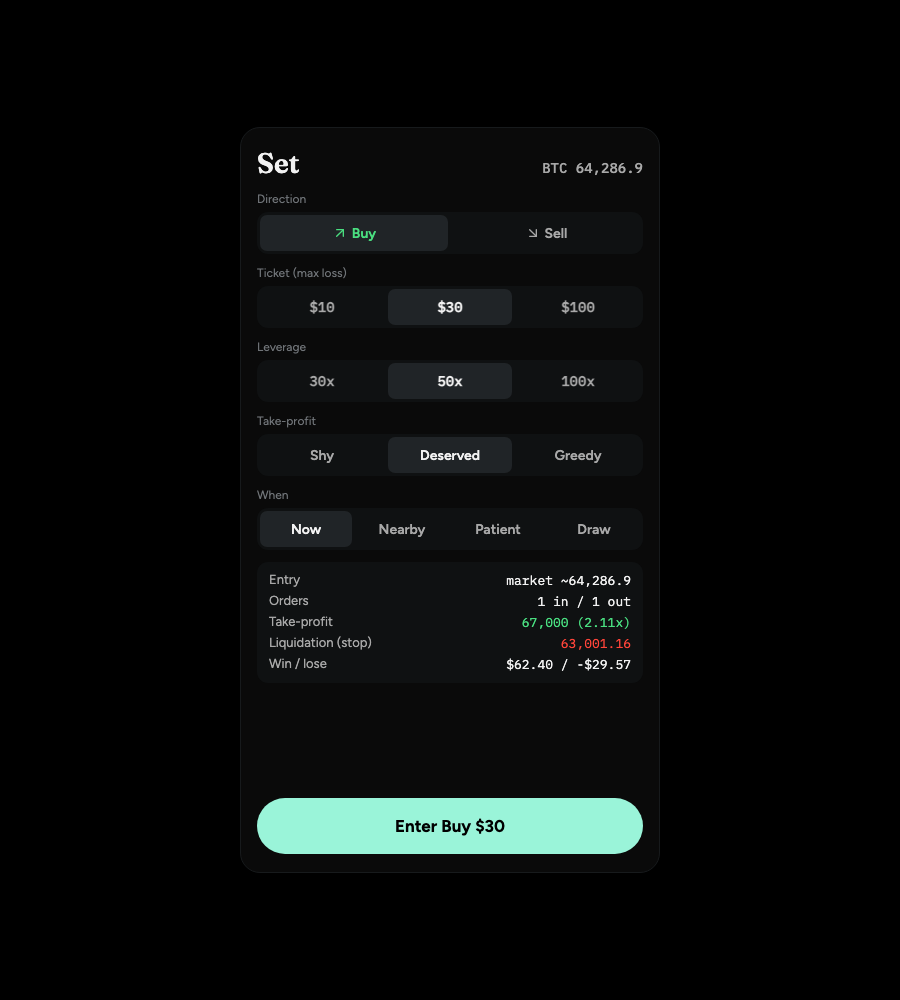

# One-click mini trade: the Set

A **Set** is a leveraged trade opened with one button. On one portrait card the user picks:

- **Direction**: Buy or Sell (default Buy).
- **Ticket**: $10, $30 or $100 (default $10). This is the margin; on isolated margin it is the most the user can lose.
- **Leverage**: 30x or 50x on the card (default 30x). 100x is an advanced choice inside the options sheet.
- **One summary row**, for example "Deserved · Nearby ›" with the target price, the win and the max loss. Tapping it opens the options sheet with:
  - **Take-profit**: Shy (at least 1x the loss), Deserved (at least 2x, the default) or Greedy (at least 4x).
  - **When to enter**: Now (market order), Nearby (the default), Patient, or Draw (paint an In band and an Out band on a price strip; the ticket is split into up to 5 orders).

How each piece is chosen (rules of 2026-11-16):

- **Stop**: every Set carries a stop just before liquidation, at 85% of the way from entry to the liquidation price. Stopped there, the user keeps about 15% of what liquidation would take and pays no liquidation fee (Aster's BTCUSDT liquidation fee is 2.5% of the position), and because the stop is a normal signed order, Blackboard's builder fee applies to the close. The take-profit ratio is measured against this stop distance, because it is the real loss.
- **Nearby**: not the nearest level. Skilled traders' resting limit orders on the good side (bids below the price for a Buy) between 0.05% and 0.5% away are grouped into 0.05%-wide price bands; the 3 heaviest bands by dollars stay; one is picked at random, weighted by dollars; then a random price inside that band.
- **Patient**: a limit inside the heaviest cluster of other traders' liquidation prices 0.5% to 5% away (longs below the price for a Buy, shorts above for a Sell). It now reads up to about 200 Hyperliquid traders (the 50 most profitable this month plus the 150 most active by volume). When there is no cluster it falls back to Nearby, and the card says so.
- **Take-profit**: first the minimum (1x, 2x or 4x the stop distance), then the heaviest wall of resting orders on the other side between that minimum and 1.5 times it (asks above a Buy, bids below a Sell), from Aster's own order book plus skilled Hyperliquid traders' resting orders. The target sits just in front of that wall, moved at random by up to 0.03%, never below the minimum. No wall, then the nearest round number beyond the minimum.

Every limit price is moved at random by up to 0.05% so many Sets never stack on one number. All randomness comes from one injected random source, so a seed reproduces a Set exactly (tests use this; the preview route accepts `"seed"`). On a winning Set, 5% of the profit goes to Blackboard and 5% to the copied trader; a losing Set pays nothing.

Orders go to **Aster**. Skilled traders' levels come from **Hyperliquid**, because Aster does not publish other users' positions or orders while Hyperliquid's are public. BTC and ETH trade at nearly the same price on both.

## The four parts, and what Blackboard copies

| Part | Folder | Copy into Blackboard? |
|---|---|---|
| Core maths: entry, nudge, take-profit, stop, liquidation, Draw split, fees, alerts, input checks | `src/core/` | Yes, first and as is. Plain TypeScript, no network, no React, no dependencies. |
| Trader levels from Hyperliquid | `src/levels/hyperliquid.ts` | Yes, on a backend (it downloads a 39 MB leaderboard and makes about 200 requests per refresh, at most one refresh a minute; keep it off phones). |
| Aster V3 client: EIP-712 signing, orders, order book, brackets, positions, builder fields | `src/exchange/aster.ts` | Yes, where the signing key lives. `asterTypedData()` also works with a Privy wallet's signTypedData. |
| The card | `src/components/` (`SetCard.tsx`, `SetOptionsSheet.tsx`, `setSummary.ts`, `PriceStrip.tsx`, `useSetSession.ts`) | Yes. Pass your own `api` prop (see `src/api/client.ts`) instead of the demo server. Colours and fonts come from `src/theme.ts`. |

`server/` is a demo signing server. It shows the contract (routes below) and is the only place a private key lives; the browser never sees one.

Stack, matching Blackboard's app: React 18, TypeScript (strict), Vite, styled-components, TanStack Query, viem, lucide-react, Vitest.

## Setup

1. `npm install`
2. Optional, only for live orders: copy `.env.example` to `.env` and fill these four values:
   - `ASTER_USER`: the main account address (on Blackboard: Settings, Account, the embedded EVM address).
   - `ASTER_SIGNER`: the API wallet address you authorised on Aster's API wallet page (https://www.asterdex.com/en/api-wallet, "Pro API").
   - `ASTER_SIGNER_PRIVATE_KEY`: that API wallet's private key.
   - `LIVE_TRADING`: leave `false` until you mean it.
3. `npm run server` (the demo server on http://127.0.0.1:8787)
4. In a second terminal: `npm run dev`, then open http://localhost:5173

Other scripts: `npm test`, `npm run typecheck`, `npm run build`.

## Trial mode and live mode

- **Trial (default).** `POST /api/set/place` builds the full plan, logs it to `logs/plans.jsonl`, and answers `"status": "trial: not sent"`. The card then follows the Set on the live price as a simulation (progress bar, halfway alert, result with fee split).
- **Live.** Only when all three hold: `LIVE_TRADING=true`, the ticket is at most `MAX_LIVE_TICKET_USD` (default $10), and the symbol is BTCUSDT or ETHUSDT. At start the server checks the key belongs to `ASTER_SIGNER` and makes one signed read; if either fails it stops with a message. A live Set: switches the symbol to isolated margin (so the ticket really is the most you can lose), sets the leverage, reads Aster's leverage brackets (the maintenance margin rate), then sends each entry with its take-profit and its stop as one OTOCO order: once the entry fills, Aster places both exits, and whichever fills cancels the other.
- **After the fill.** `reconcileStop()` in `server/execute.ts` reads Aster's own liquidation price (`GET /fapi/v3/positionRisk`, `liquidationPrice`) and moves the stop to 85% of that real distance when the estimate was off by more than one tick. Blackboard should call it once the entry fills; the demo server does not call it on its own yet.
- **Builder attribution.** Set `ASTER_BUILDER_ADDRESS` and `ASTER_BUILDER_FEE_RATE` (a decimal fraction, for example `0.0001` = 0.01%, at most `0.001`, Blackboard's approval ceiling) to add `builder` and `feeRate` to every signed order, the stop included.

## Server routes

- `GET /api/price?symbol=BTCUSDT`: the latest Aster price.
- `GET /api/levels?coin=BTC`: skilled traders' resting orders, take-profits and liquidation prices, with counts (addresses read, positions with a liquidation price, orders, request weight spent).
- `POST /api/set/preview`: the full plan (entry, nudged price, quantity, stop, liquidation, take-profit and the wall it sits in front of, ratio, expected win and max loss, fee split, structural counts) plus the exact Aster order legs. Body: `{"symbol":"BTCUSDT","side":"buy","ticketUsd":10,"leverage":30,"tpMode":"deserved","entryMode":"nearby"}`; add `"seed": 1` to repeat the same random picks; Draw adds `"draw":{"inBand":{"low":..,"high":..},"outBand":{"low":..,"high":..}}`.
- `POST /api/set/place`: same body; trial or live as above.

## Risk notes

- **Stop just before liquidation.** The stop is a stop-market order: in a sudden gap it can fill worse than its price, and if price jumps past liquidation the venue liquidates instead. On isolated margin the loss is still capped at the ticket; on cross margin it is not, which is why live mode switches to isolated first.
- **The max loss shown is the loss at the stop**, before exchange trading fees and funding. With a $10 ticket at 30x it is about $6.20 (smoke run 2026-11-16), because the quantity is rounded down to Aster's 0.001 BTC step and the stop sits at 85% of a distance already shortened by the maintenance margin.
- **Leverage rules differ by country.** Several countries cap retail leverage on crypto derivatives or ban them outright; check where each user lives before offering 30x to 100x.
- **Levels are a guide, not a promise.** A level that mattered on Hyperliquid may not hold on Aster.

## Open items

- Aster's V3 doc lists `builder` and `feeRate` only on the strategy order endpoint, which is what live Sets use. Adding them to a plain `POST /fapi/v3/order` is done because Blackboard's guide asks for it, but that table does not list them, and the doc says unlisted parameters are rejected. The first live $10 Set will show which holds.
- The doc's two signing examples differ: one signs `nonce` and `signer`, the other `nonce`, `user` and `signer`. This client signs all three (the doc's authentication table). If Aster answers a signature error, set `includeUserInSignedString: false`.
- Patient needs liquidation prices near the price. With the wider set (171 traders on 2026-11-16) a Sell found a short cluster 4.15% above the price, but a Buy found no long liquidations within 5% below (8 longs below the price, none inside the window), so a Patient Buy fell back to Nearby. Hyperliquid's public liquidation feed would add more.
- Live OTOCO wiring is our reading of the doc. The V3 doc lists OTOCO and the `secondDrivenId` / `secondDrivenOn` / `secondTrigger` fields but prints no OTOCO example. The first live $10 Set will show whether Aster accepts the three legs as built in `server/execute.ts`.
- Before the fill, trial mode has no leverage brackets (a signed call), so it assumes a 0.5% maintenance margin rate. Live mode reads the real brackets; after the fill, `reconcileStop()` uses Aster's own liquidation price.
